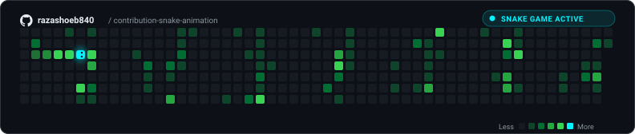
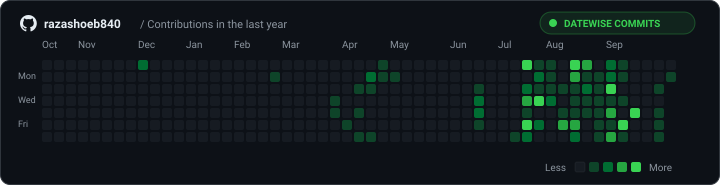

<div align="center">

<!-- 01 HERO SECTION -->
<a href="https://portfolio-kappa-dun-13.vercel.app/">
  
</a>

<br/>

<!-- 02 ABOUT & CAPABILITIES -->


<br/>

<!-- 03 TECHNICAL ORBITS & STACK -->


<br/>

<!-- 04 VERIFIED DOSSIER & LANYARD ID -->


<br/>

<!-- 05 CONNECT & CHANNELS -->


<br/>

<!-- REAL CLICKABLE SOCIAL DISPATCH LINKS (GitHub SVGs cannot embed external web links) -->
<p align="center">
  <a href="https://portfolio-kappa-dun-13.vercel.app/">
    
  </a>
  <a href="./assets/Shoeb_Raza_Resume.pdf">
    
  </a>
  <a href="https://www.linkedin.com/in/shoeb-raza/">
    
  </a>
  <a href="https://leetcode.com/u/razashoeb2358/">
    
  </a>
  <a href="https://www.codechef.com/users/razashoeb2358">
    
  </a>
  <a href="https://wa.me/918406022747">
    
  </a>
</p>

</div>

<br/>

---

### 🚀 PRODUCTION DEPLOYMENTS & SYSTEM ARCHITECTURES

<table>
  <!-- PROJECT 1: JANSETU -->
  <tr>
    <td width="48%" valign="middle" align="center">
      <a href="https://jansetu-h177.onrender.com/">
        
      </a>
      <br/><br/>
      <a href="https://jansetu-h177.onrender.com/">
        
      </a>
      <a href="https://github.com/razashoeb840/JanSetu1">
        
      </a>
    </td>
    <td width="52%" valign="top">
      <h3>#01 · JanSetu  </h3>
      <p><b>Domain:</b> Civic Tech • Automated AI Triage • Triple-Helix Resolution</p>
      <p><i>Citizen-to-Innovation platform connecting citizens, municipal bodies, universities, and industry to report, track, and resolve societal challenges.</i></p>
      <ul>
        <li><b>Multi-Modal Evidence Submission:</b> Ingests photo, video, audio voice notes, and GPS geolocation with offline sync.</li>
        <li><b>AI Triage Dispatch:</b> Classifies issues, detects duplicates, scores priority, and routes submissions to verified civic departments in sub-second latency.</li>
        <li><b>Verified Loop:</b> University & industry problem-matching pipeline for collaborative execution and citizen sign-off.</li>
      </ul>
      <p>
        
        
        
        
        
      </p>
      <p><b>Telemetry:</b> <code>100% Audit Trail</code> | <code>5+ Stakeholder Tiers</code> | <code>Sub-sec Routing</code></p>
    </td>
  </tr>

  <!-- PROJECT 2: MEDIPULSE -->
  <tr>
    <td width="48%" valign="middle" align="center">
      <a href="https://deploy-fcr3.onrender.com/1index.html">
        
      </a>
      <br/><br/>
      <a href="https://deploy-fcr3.onrender.com/1index.html">
        
      </a>
      <a href="https://github.com/razashoeb840/deploy">
        
      </a>
    </td>
    <td width="52%" valign="top">
      <h3>#02 · MediPulse  </h3>
      <p><b>Domain:</b> HealthTech • Real-Time Telemetry • Unified Clinical Ledger</p>
      <p><i>Unified smart hospital platform governing patient registration, live bed & ICU occupancy telemetry, doctor consultation desks, pharmacy automation, and billing.</i></p>
      <ul>
        <li><b>Sub-Second Bed & Ward Telemetry:</b> Real-time streaming tracks ICU and general bed capacity with Socket.io push broadcasts.</li>
        <li><b>Digital Rx & Token Flow:</b> Seamless patient queue, ABHA ID linkage, and digital prescription generation synchronized with pharmacy dispatch.</li>
        <li><b>Strict RBAC:</b> 4 isolated operational consoles: Admin, Doctor, Receptionist, and Cashier.</li>
      </ul>
      <p>
        
        
        
        
        
      </p>
      <p><b>Telemetry:</b> <code>Zero Collisions</code> | <code>4-Role Strict RBAC</code> | <code>24/7 Ward Telemetry</code></p>
    </td>
  </tr>

  <!-- PROJECT 3: RAPIDX -->
  <tr>
    <td width="48%" valign="middle" align="center">
      <a href="https://rapidx-transit.onrender.com/">
        
      </a>
      <br/><br/>
      <a href="https://rapidx-transit.onrender.com/">
        
      </a>
      <a href="https://github.com/razashoeb840/rapidX">
        
      </a>
    </td>
    <td width="52%" valign="top">
      <h3>#03 · RapidX  </h3>
      <p><b>Domain:</b> Transit & Logistics • Real-Time Allocation Engine</p>
      <p><i>High-concurrency task allocation engine pairing service requests with proximate active helpers via spatial geohashing and dynamic load balancing.</i></p>
      <ul>
        <li><b>Spatial Matchmaking:</b> Matches tasks with drivers in under 1 second based on real-time geohash clustering and queue weights.</li>
        <li><b>Atomic Claim Transactions:</b> Prevents concurrent job grabs using MongoDB optimistic concurrency locks.</li>
        <li><b>Live Operational Radar:</b> Interactive dispatcher telemetry tracking driver GPS pings and ETA updates via WebSockets.</li>
      </ul>
      <p>
        
        
        
        
      </p>
      <p><b>Telemetry:</b> <code>&lt;1s Matching</code> | <code>100% Atomic Integrity</code> | <code>Zero Grab Collisions</code></p>
    </td>
  </tr>

  <!-- PROJECT 4: AI STUDY SUITE PRO -->
  <tr>
    <td width="48%" valign="middle" align="center">
      <a href="https://ai-study-suite-alpha.vercel.app">
        
      </a>
      <br/><br/>
      <a href="https://ai-study-suite-alpha.vercel.app">
        
      </a>
      <a href="https://github.com/razashoeb840/AI_Study_suite">
        
      </a>
    </td>
    <td width="52%" valign="top">
      <h3>#04 · AI Study Suite Pro  </h3>
      <p><b>Domain:</b> EdTech • Document Intelligence • Generative AI</p>
      <p><i>Intelligent academic workspace ingesting textbooks and lecture slides to synthesize chapter breakdowns, active-recall flashcards, and diagnostic exams.</i></p>
      <ul>
        <li><b>Semantic PDF Ingestion:</b> Chunking pipeline tokenizes slide decks and syllabi with context-aware windowing.</li>
        <li><b>Gemini API Generation:</b> Automated synthesis of high-yield active-recall cards and dynamic multiple-choice test banks.</li>
        <li><b>Cognitive Spaced Repetition:</b> Retention curve tracking identifying topic weaknesses for targeted review.</li>
      </ul>
      <p>
        
        
        
        
      </p>
      <p><b>Telemetry:</b> <code>100% Auto-Quiz</code> | <code>Multi-Doc Ingestion</code> | <code>Instant LLM Synthesis</code></p>
    </td>
  </tr>

  <!-- PROJECT 5: FOCUSGUARD PRO -->
  <tr>
    <td width="48%" valign="middle" align="center">
      <a href="https://github.com/sushantranjan912/FocusguardPro-hackathon">
        
      </a>
      <br/><br/>
      <a href="https://github.com/sushantranjan912/FocusguardPro-hackathon">
        
      </a>
    </td>
    <td width="52%" valign="top">
      <h3>#05 · FocusGuard Pro  </h3>
      <p><b>Domain:</b> Productivity Tech • Chrome Extension • Low-Latency Controls</p>
      <p><i>Ultra-lightweight browser extension curbing digital distractions through deterministic Declarative Net Request URL filtering and tamper-resistant timers.</i></p>
      <ul>
        <li><b>0ms Interception Overhead:</b> Utilizes native Manifest V3 network rules for instant blocking without background lag.</li>
        <li><b>Anti-Override Focus Lock:</b> Tamper-proof Pomodoro timers backed by encrypted browser local storage.</li>
        <li><b>Screen-Time Telemetry:</b> Visual heatmaps showcasing saved minutes and milestone streaks.</li>
      </ul>
      <p>
        
        
        
      </p>
      <p><b>Telemetry:</b> <code>0ms Overhead</code> | <code>100% Privacy</code> | <code>Manifest V3 Compliant</code></p>
    </td>
  </tr>
</table>

<br/>

---

### 🐍 LIVE TELEMETRY & CONTRIBUTION SNAKE GAME

<div align="center">

<p align="center">
  <b>🎮 Real 365-Day Contribution Snake Slither (Datewise Commits)</b>
</p>

<!-- SNAKE ANIMATION SVG -->


<br/><br/>

<p align="center">
  <b>🟩 Datewise Commits Activity Grid (Exact GitHub Black &amp; Neon Green)</b>
</p>

<!-- STATIC DATEWISE COMMIT GRAPH -->


<br/><br/>

<table border="0" width="100%">
  <tr>
    <td align="center" valign="middle" width="50%">
      
    </td>
    <td align="center" valign="middle" width="50%">
      
    </td>
  </tr>
  <tr>
    <td colspan="2" align="center" valign="middle">
      
    </td>
  </tr>
</table>

</div>

<br/>

---

### 🍿 POST-CREDITS & CONTINUE WATCHING

<div align="center">

<h3><i>"Engineering high-throughput systems, line by line."</i></h3>

<p>
  <a href="https://portfolio-kappa-dun-13.vercel.app/">
    
  </a>
  <a href="./assets/Shoeb_Raza_Resume.pdf">
    
  </a>
  <a href="https://www.linkedin.com/in/shoeb-raza/">
    
  </a>
  <a href="mailto:razashoeb840@gmail.com">
    
  </a>
  <a href="https://wa.me/918406022747">
    
  </a>
</p>

<br/>

```
╔════════════════════════════════════════════════════════════════════════════╗
║                   TO BE CONTINUED... SEASON 06 COMING SOON                 ║
║       Current Production: Scalable Distributed Systems & Real-Time AI       ║
╚════════════════════════════════════════════════════════════════════════════╝
```

<br/>

<a href="#top"><b>▲ RETURN TO TOP</b></a>

</div>
